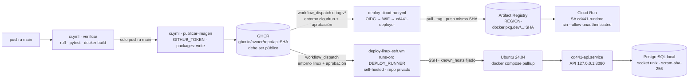

# cd441 · Estado técnico, pruebas pendientes y cómo retomar

> Documento interno de Cloudevel. Fecha de corte: **27 de noviembre de 2026**. Lo escribe el equipo técnico a pedido de José Luis («Documenta a profundidad. Este curso no está planeado en un futuro próximo»).
> Aquí aparecen **solo nombres** de variables y secretos, nunca valores. Los `<…>` son marcadores que se rellenan al retomar.
> Las pruebas en vivo (GCP, runner, SSH) están **en pausa**: no se ha creado ningún recurso en la nube para este curso.

## Índice

1. [Estado verificado](#1-estado-verificado)
2. [Arquitectura](#2-arquitectura)
3. [Variables y secretos por entorno](#3-variables-y-secretos-por-entorno-solo-nombres)
4. [Plan de prueba en vivo](#4-plan-de-prueba-en-vivo)
5. [Qué falta por probar](#5-qué-falta-por-probar)
6. [Decisión abierta: /health en Cloud Run privado](#6-decisión-abierta-health-en-cloud-run-privado)
7. [Revisores obligatorios y plan de GitHub](#7-revisores-obligatorios-y-plan-de-github)
8. [Acciones fijadas que envejecen](#8-acciones-y-versiones-fijadas-que-envejecen)
9. [Estado de cd101](#9-estado-de-cd101)
10. [Problemas conocidos y riesgos](#10-problemas-conocidos-y-riesgos)
11. [Cómo retomar](#11-cómo-retomar)

---

## 1. Estado verificado

| Hecho | Cómo se sabe |
|---|---|
| `origin/main` = **`fd0e9ab`** («Publica la duración del curso (20 horas) en el README.») | Comprobado con `git fetch` (solo lectura) el 27-nov-2026. La rama `main` local del clon estaba desactualizada (`9d9096f`), así que se usó `origin/main`. |
| El código (`api/`, `Dockerfile`, `.github/`) no cambia entre `183d225` y `fd0e9ab` | `git diff 183d225 fd0e9ab` fuera de los cuadernos solo toca `README.md` y `.devcontainer/devcontainer.json` (instalación de kernels). |
| Validación local sobre el mismo código (`183d225`) | Con ruff, pytest (26 pasan y 3 se saltan sin PostgreSQL; cobertura 85,23 %), actionlint, yamllint, shellcheck y `docker build`. `/health` responde, el contenedor corre como UID 10001 y `/app` no es escribible. gitleaks no encontró nada en el árbol ni en la historia. |
| **CI verde en GitHub para `fd0e9ab`** | Primero lo informaron Jefe de gabinete y José Luis. Además se **confirmó en solo lectura** con la API pública de GitHub: la ejecución «CI» del `push` del 27-nov-2026 a las 08:16 (hora de Ciudad de México, UTC−6) terminó en `success`, con los jobs `verificar` (`success`) y `publicar-imagen` (`success`). Dejó los artefactos `cobertura-pytest` y el registro de *buildx*. Las ejecuciones de Dependabot también salieron bien. |
| **Paquete en GHCR** `ghcr.io/cloudevel/cd441/api:<sha>` | Que existe lo informaron Jefe de gabinete y José Luis, y lo respalda el `success` de `publicar-imagen`. **No se pudo descargar de forma anónima.** El *token* anónimo de `ghcr.io` responde `401 authentication required` para `cloudevel/cd441/api`, mientras que un nombre inexistente da `403` y un paquete público conocido da `200`. Eso indica que **el paquete existe pero sigue privado**. Hay que hacerlo público (véase §4, paso 3) antes de cualquier despliegue. |
| Repositorio `Cloudevel/cd441` público, rama por omisión `main` | API pública de GitHub (solo lectura). |
| Nada desplegado en Cloud Run, Artifact Registry ni ningún anfitrión Linux | No se ha ejecutado ningún `gcloud`, ningún runner ni ningún SSH. |

---

## 2. Arquitectura

### 2.1 API (`api/`)

- **Flask 3.1.3 y gunicorn 27.0.1**, con 1 *worker*, 4 *threads* y `--timeout 30`, en el puerto `PORT` (8080 por omisión). La entrada es `api/wsgi.py` y la fábrica de la app está en `api/app/__init__.py`.
- **Configuración** (`api/app/config.py`), toda por variables de entorno:
  - `SECRET_KEY`: si falta, se genera una aleatoria por proceso.
  - `APP_VERSION`: el SHA, que inyectan los workflows.
  - `DATABASE_URL`: opcional.
- **Almacén** (`api/app/almacen.py`): en memoria por omisión, o **PostgreSQL** (psycopg 3.3.9) si existe `DATABASE_URL`.
- **Rutas** (`api/app/routes.py`): `GET /health`, y en `/tareas` las operaciones `GET`, `POST`, `GET/PATCH/DELETE /tareas/<id>`.
- **`/health`** devuelve `{"status","version","almacen"}`, donde `almacen` es `memoria` o `postgresql`. Responde **503** si hay base de datos configurada y no contesta.
- **Pruebas** en `api/tests/`: `test_health`, `test_tareas` y `test_postgres`. Las 3 de PostgreSQL se saltan si no está definida `TEST_DATABASE_URL`. La cobertura mínima es 80 % (`pyproject.toml`).

### 2.2 Dockerfile (endurecido)

- La base es `python:3.12-slim-trixie` **fijada por digest** (`@sha256:…`); Dependabot (ecosistema `docker`) propone las actualizaciones.
- Corre con el usuario de sistema **UID/GID 10001**, sin *home* y con *shell* `nologin`. El código se copia como root y **no es escribible** por la app.
- `PIP_NO_CACHE_DIR`, sin bytecode, y dependencias con versión fija.
- `HEALTHCHECK` contra `/health`, `EXPOSE 8080`, y `CMD` con `exec gunicorn` para que gunicorn sea PID 1 y reciba las señales.
- `.dockerignore` excluye `.git`, `.github`, `.devcontainer`, entornos virtuales, cachés, cuadernos, imágenes, `api/tests`, `api/deploy` y cualquier secreto local (`.env*` salvo `.env.example`, `*.pem`, `*.key`, `id_ed25519*`).

### 2.3 Workflows (`.github/workflows/`)

Todos tienen `permissions` mínimos por job, acciones **fijadas por SHA**, `persist-credentials: false` y `concurrency`.

| Workflow | Disparadores | Jobs y comportamiento |
|---|---|---|
| `ci.yml` («CI») | `push` (cualquier rama), `pull_request`, `workflow_dispatch` | **`verificar`** (en `ubuntu-latest`): Python 3.12, ruff, pytest con cobertura, artefacto `cobertura-pytest` (con `if: always()`) y `docker build -t cd441-api:ci .`, sin publicar. **`publicar-imagen`**: depende de `verificar` y **solo corre en `push` a `main`**. Tiene `packages: write` y usa `GITHUB_TOKEN`, sin PAT. *buildx* publica `ghcr.io/<owner>/<repo>/api:<sha>` en minúsculas, con etiquetas OCI y caché de GHA. |
| `deploy-cloud-run.yml` («Despliegue en Cloud Run») | `workflow_dispatch` y etiquetas `v*` | Job `desplegar` en el entorno **`cloudrun`**, con `id-token: write`. Pasos: valida las variables; se autentica con **OIDC y Workload Identity Federation** (`google-github-actions/auth`), sin llaves JSON; **promociona** la imagen de GHCR del mismo SHA a Artifact Registry (*pull*, *tag* y *push*, sin reconstruir; con una etiqueta `v*` añade además esa etiqueta); ejecuta `gcloud run deploy` con `--service-account GCP_RUNTIME_SA`, `--max-instances 1` y `APP_VERSION=SHA`, **sin `--allow-unauthenticated`**; por último comprueba `/health` y la versión con `curl` **sin token** (véase §6). |
| `deploy-linux-ssh.yml` («Despliegue en Linux por SSH») | `workflow_dispatch` | Job `desplegar` en el entorno **`linux`**, con `runs-on: ${{ vars.DEPLOY_RUNNER \|\| 'self-hosted' }}`. Una protección (*guard*) **falla si un runner propio se usa en un repo público**. Valida las entradas con expresiones regulares. La clave SSH va en `$RUNNER_TEMP` y se borra con `if: always()`. `known_hosts` se fija desde un secreto y se usa `StrictHostKeyChecking=yes`. El *script* remoto va en un *heredoc* entre comillas: escribe `.env` con `API_IMAGE` y `APP_VERSION`, luego `docker compose pull` y `up -d --wait`, y comprueba `/health` en `127.0.0.1:8080`. |

`DEPLOY_RUNNER` vale `self-hosted` por omisión, para cuando el anfitrión está detrás de NAT o en una red privada. Si el anfitrión tiene IP pública y SSH abierto, puede ser `ubuntu-latest`.

`.github/dependabot.yml` revisa cada mes los ecosistemas `github-actions` (/), `pip` (/api) y `docker` (/).

### 2.4 Guiones de GCP (`api/deploy/gcp/`)

Los ejecuta **una persona propietaria del proyecto**, desde un Codespace o desde Cloud Shell. Todos son idempotentes y cargan antes `variables.sh`.

| Guion | Qué hace |
|---|---|
| `variables.sh` | Exige `GCP_REGION` y toma `GCP_PROJECT_ID` del entorno o de `gcloud config`. Valores por omisión: `AR_REPOSITORY=cd441`, `CLOUD_RUN_SERVICE=cd441-api`, SAs `cd441-runtime` y `cd441-deployer`. |
| `preparar_proyecto.sh` | Habilita las API `run`, `artifactregistry`, `iam`, `iamcredentials` y `sts`. Crea el repositorio Docker de Artifact Registry y las SAs `cd441-runtime` (**sin roles**) y `cd441-deployer`. A esta le da `roles/run.developer` en el proyecto, `roles/artifactregistry.writer` **solo en ese repositorio** y `roles/iam.serviceAccountUser` **solo sobre `cd441-runtime`**. No crea llaves. |
| `configurar_wif.sh` | Necesita `GITHUB_REPO=<owner>/<repo>`. Crea el pool `github` y el proveedor OIDC `cd441-actions` (emisor `token.actions.githubusercontent.com`) con la **condición de atributos** `assertion.repository == '<repo>' && assertion.environment == 'cloudrun'`. Concede `roles/iam.workloadIdentityUser` sobre `cd441-deployer` al `principalSet` del repositorio e imprime el valor de `GCP_WIF_PROVIDER`. |
| `desplegar_manual.sh` | Es el **primer despliegue**, hecho por la persona: *build*, *push* a Artifact Registry y `run deploy` **con `--allow-unauthenticated`**. Ese permiso de IAM no lo tiene el workflow. Al final llama a `comprobar.sh`. |
| `comprobar.sh` | Muestra la URL, las últimas revisiones y las imágenes de Artifact Registry, y hace `curl /health` sin token. |
| `limpiar.sh` | Pide confirmación y borra el servicio de Cloud Run, el repositorio de Artifact Registry, el pool de WIF y las dos SAs. |

### 2.5 Destino Linux (`api/deploy/`)

- **`preparar_anfitrion.sh`** se ejecuta como root, una vez, en un **Ubuntu 24.04 completo con systemd**; en Codespaces no funciona. Es idempotente:
  1. instala `docker.io`, Compose v2, PostgreSQL y curl;
  2. crea el usuario `deploy` (por omisión) y le autoriza **solo** la clave Ed25519 que recibe;
  3. crea el directorio (por omisión `/opt/cd441`);
  4. crea el rol y la base `cd441` con una contraseña aleatoria y limita `pg_hba` a `local cd441 cd441 scram-sha-256`;
  5. escribe `/etc/cd441/api.env` (`DATABASE_URL` y `SECRET_KEY`, modo 640 `root:deploy`), así que **esos secretos no pasan por GitHub**;
  6. instala la unidad systemd;
  7. imprime la huella de la clave del servidor.
- **`compose.yaml`** define el servicio `api` con `image: ${API_IMAGE}`:
  - puerto `127.0.0.1:8080`;
  - `env_file /etc/cd441/api.env`;
  - el socket de PostgreSQL montado **en solo lectura**;
  - `read_only`, `tmpfs /tmp`, `cap_drop: [ALL]` y `no-new-privileges`.
- **`cd441-api.service`** es una plantilla con `@DEPLOY_DIR@` y `@DEPLOY_USER@`: `Type=oneshot`, `docker compose up -d --wait` y `down`, y depende de `docker.service` y `postgresql.service`.

### 2.6 Codespaces (`.devcontainer/devcontainer.json`)

- *Dockerfile* propio (`.devcontainer/Dockerfile`) sobre `mcr.microsoft.com/devcontainers/python:3.3.4-3.12-bookworm`, fijada por **versión, no por digest**.
- `gcloud` se instala desde el repositorio oficial de Google con keyring `signed-by` y versión fija (`GCLOUD_VERSION`). Sustituye a la *feature* de terceros `dhoeric/features/google-cloud-cli`, sin mantenimiento desde 2023 y basada en `apt-key`.
- *Features* fijadas: `docker-in-docker:4.1.3` y `github-cli:1.1.3`, con digest en `devcontainer-lock.json`.
- `forwardPorts [8080]` (el 2222 se quitó).
- Kernels y herramientas de ejecución fijados en `.devcontainer/requirements.txt` (`ipykernel`, `bash_kernel`, `nbformat`, `nbclient`, `pyyaml`), instalados en la imagen.
- CI de cuadernos aparte (`notebooks.yml`): construye el devcontainer y ejecuta del 01 al 15; omite el 16 y el 17.
- `remoteUser: vscode`.
- Codespaces es el entorno principal. **Solo el destino del cuaderno 17** (systemd y PostgreSQL nativo) exige un Ubuntu 24.04 real.

### 2.7 Flujo



---

## 3. Variables y secretos por entorno (solo nombres)

| Entorno | Nombre | Tipo | Para qué |
|---|---|---|---|
| `cloudrun` | `GCP_PROJECT_ID` | Variable | ID del proyecto |
| `cloudrun` | `GCP_REGION` | Variable | Región de Artifact Registry y Cloud Run |
| `cloudrun` | `AR_REPOSITORY` | Variable | Repositorio Docker de Artifact Registry |
| `cloudrun` | `CLOUD_RUN_SERVICE` | Variable | Nombre del servicio |
| `cloudrun` | `GCP_WIF_PROVIDER` | Variable | Ruta completa del proveedor de WIF (la imprime `configurar_wif.sh`) |
| `cloudrun` | `GCP_DEPLOY_SA` | Variable | Correo de `cd441-deployer` |
| `cloudrun` | `GCP_RUNTIME_SA` | Variable | Correo de `cd441-runtime` |
| `linux` | `SSH_HOST` | **Secreto** | Anfitrión |
| `linux` | `SSH_USER` | **Secreto** | Usuario de despliegue |
| `linux` | `SSH_PORT` | **Secreto** | Puerto SSH |
| `linux` | `SSH_PRIVATE_KEY` | **Secreto** | Clave privada Ed25519 exclusiva |
| `linux` | `SSH_KNOWN_HOSTS` | **Secreto** | Línea de `known_hosts` del servidor, ya verificada |
| `linux` | `SSH_DEPLOY_DIR` | Variable | Directorio de despliegue (p. ej. `/opt/cd441`) |
| `linux` | `DEPLOY_RUNNER` | Variable opcional | `self-hosted` (por omisión) o `ubuntu-latest` |
| (CI) | `GITHUB_TOKEN` | Automático | Publicar en GHCR (`packages: write` solo en `publicar-imagen`) |

El entorno `cloudrun` **no tiene secretos**: OIDC sustituye al antiguo secreto `GCP_SA_KEY` (llave JSON), que se eliminó a propósito. `DATABASE_URL` y `SECRET_KEY` del destino Linux viven solo en `/etc/cd441/api.env` del anfitrión.

---

## 4. Plan de prueba en vivo

Basado en `plan_prueba_en_vivo.md`. **Precios consultados el 27-nov-2026** en las páginas oficiales enlazadas, en USD tal como se publican. Conviene volver a consultarlos al retomar.

### 4.0 Qué aporta José Luis

- **Proyecto de GCP nuevo y dedicado**, con facturación, a ser posible personal y **fuera de cualquier organización** (véase §10).
  - Rol **Owner**.
  - Alternativa con roles mínimos: `serviceusage.serviceUsageAdmin`, `artifactregistry.admin`, `iam.serviceAccountAdmin`, `iam.serviceAccountUser`, `iam.workloadIdentityPoolAdmin`, `resourcemanager.projectIamAdmin`, `run.admin`, más `billing.user`.
- **Quién ejecuta los guiones de GCP:** José Luis, con su cuenta, desde el Codespace de cd441 o desde Cloud Shell.
- **En `Cloudevel/cd441`:** el entorno `cloudrun` con revisores obligatorios y la regla de despliegue «solo `main` y etiquetas `v*`», más las 7 variables de §3.
- **Un repositorio privado para el runner:** una copia importada o desde plantilla, porque un *fork* de un repo público no puede ser privado. Lleva el entorno `linux` y sus nombres de §3; véase también §7.
- **Una máquina Ubuntu 24.04 completa y desechable:** una VM local o una `e2-small`.
- **Claves:** José Luis genera el par Ed25519 en su equipo. Obtiene `SSH_KNOWN_HOSTS` con `ssh-keyscan -t ed25519 -p <puerto> <host>` y comprueba la huella con la que imprime el servidor. Nunca se usa `ssh-keyscan` dentro del pipeline.

### 4.1 Codespaces (≈ 1 h; 2 núcleos; unas 6 núcleo-hora entre los dos cursos)

**cd441**
1. La construcción termina y el `postCreateCommand` acaba con código 0.
2. `jupyter kernelspec list` muestra `bash` y `python3`. Responden `docker info`, `gh --version` y `gcloud --version`, y `id -un` es `vscode`.
3. `pip install -r api/requirements-dev.txt`, `ruff check`, y `pytest` (26 pasan y 3 se saltan).
4. **Prueba de humo con PostgreSQL:**
   - `postgres:16` en contenedor, publicado solo en `127.0.0.1`, con una contraseña generada en el momento con `openssl rand` que no se escribe en ningún archivo;
   - con `TEST_DATABASE_URL=… pytest` pasan las 3 pruebas que antes se saltaban;
   - la API con `DATABASE_URL` responde en `/health` con `"almacen":"postgresql"`, y `/tareas` funciona;
   - `docker run` de la imagen corre como el UID 10001.
5. Abrir los cuadernos 13 a 17 con el kernel correcto.

**cd101**
1. Se construye desde `.devcontainer/Dockerfile` (`devcontainers/base:ubuntu-24.04`, `docker-in-docker:2`, puerto 8888).
2. El `postCreateCommand` (`python3 -m bash_kernel.install --user`) termina bien y el kernel Bash funciona.
3. Responden las herramientas del Dockerfile, Jupyter no corre como root y `docker run hello-world` funciona.

### 4.2 CI (≈ 30 min)

- En un PR de prueba: `verificar` en verde y `publicar-imagen` **omitido**.
- En `main`: los dos jobs en verde. En el registro hay que confirmar los SHA fijados, los permisos mínimos y que no aparece ningún secreto.
- Dependabot activo.
- El CI verde de `fd0e9ab` ya se confirmó en solo lectura (§1).

### 4.3 GHCR (≈ 20 min)

1. Abrir el paquete `cd441/api` de la organización.
2. En *Package settings → Change visibility*, ponerlo en **Public**. Antes hay que comprobar que la organización Cloudevel permite paquetes públicos.
3. Desde una máquina sin sesión: `docker logout ghcr.io && docker pull ghcr.io/cloudevel/cd441/api:<sha>`. Luego `docker run`, y `/health` debe devolver la versión igual al SHA.

### 4.4 WIF y Cloud Run (≈ 1,5 h; lo ejecuta José Luis, en este orden)

1. `export GCP_PROJECT_ID=<id> GCP_REGION=<región>` y `gcloud config set project <id>`.
2. `bash api/deploy/gcp/preparar_proyecto.sh` (véase §2.4).
3. `GITHUB_REPO=Cloudevel/cd441 bash api/deploy/gcp/configurar_wif.sh`.
4. Cargar las 7 variables en `cloudrun`.
5. `bash api/deploy/gcp/desplegar_manual.sh`: primer despliegue, público, y `comprobar.sh`.
6. Lanzar `deploy-cloud-run.yml` con `workflow_dispatch` en `main` y aprobar. Después, opcionalmente, una etiqueta `v*` de prueba.

**Qué se comprueba:**
- La autenticación es OIDC, sin llaves.
- La imagen se promociona con el mismo SHA.
- Hay una revisión nueva y `/health` devuelve la versión correcta.
- En el registro, `run deploy` no lleva `--allow-unauthenticated`.
- **Prueba negativa:** desde otra rama, entorno o repositorio no se obtiene el token.
- **Acceso con token de identidad:** se retira `allUsers` de `roles/run.invoker`. Sin token debe responder 403. Con `Authorization: Bearer $(gcloud auth print-identity-token)` debe responder 200. Esto choca con §6.

### 4.5 Runner Linux y destino (≈ 2 h)

1. `sudo bash api/deploy/preparar_anfitrion.sh <clave.pub>`, dos veces para comprobar que es idempotente. Se verifica:
   - la unidad está habilitada;
   - PostgreSQL escucha solo en `127.0.0.1` y `::1`, con `pg_hba` local y `scram-sha-256`;
   - `/etc/cd441/api.env` tiene modo `640 root:deploy`;
   - la huella del servidor coincide con `SSH_KNOWN_HOSTS`.
2. Instalar el runner **solo en el repositorio privado**: `./config.sh --url <repo> --token <token de registro> --ephemeral --labels self-hosted,linux`. Corre con un usuario sin `sudo` y distinto de `deploy`. El token de registro caduca pronto y no se guarda.
3. Ejecutar `deploy-linux-ssh.yml` y aprobar `linux`. Se comprueba:
   - el *pull* desde GHCR de la imagen de **ese** repositorio, que también debe ser pública;
   - `up --wait` y `/health` con `postgresql` y el SHA;
   - una segunda ejecución no recrea el contenedor;
   - los datos sobreviven a `systemctl restart cd441-api postgresql`;
   - con una `SSH_KNOWN_HOSTS` falsa, el despliegue se rechaza;
   - el *guard* bloquea el runner en un repositorio público.
4. Los ejercicios de systemd de cd101 en la misma VM (§9).

### 4.6 Desmontaje (≈ 30 min)

- **Runner:** al ser `--ephemeral` se desregistra solo. Hay que comprobarlo en *Settings → Actions → Runners* (o ejecutar `./config.sh remove`) y borrar `_work`.
- **GCP:**
  - `bash api/deploy/gcp/limpiar.sh`. El pool queda en estado *deleted* unos 30 días y su ID no se puede reutilizar en ese tiempo.
  - **O bien `gcloud projects delete <id>`**, la opción más limpia.
  - Revisar la facturación.
- **VM:** destruirla, con su disco y su IP externa.
- **GitHub:** retirar la clave de `deploy`, los secretos de `linux`, los Codespaces y los paquetes de prueba del repositorio privado; archivar o borrar ese repositorio.

### 4.7 Costos (USD, precios publicados, consultados el 27-nov-2026)

| Concepto | Precio oficial | Estimación |
|---|---|---|
| Codespaces ([fuente](https://docs.github.com/en/billing/concepts/product-billing/github-codespaces)) | Cuenta personal Free: 120 h de cómputo al mes (núcleo-hora; 2 núcleos cuentan doble) y 15 GB-mes. Por encima: 2 núcleos a $0.18/h y almacenamiento a $0.07/GB-mes. Los planes de organización no incluyen cuota gratuita. | ~6 núcleo-hora: $0 dentro de la cuota (unos $0.54 sin cuota) |
| Actions ([fuente](https://docs.github.com/en/billing/concepts/product-billing/github-actions)) | Runners estándar gratis en repositorios públicos y en runners autoalojados. En privados, Free incluye $12 al mes; Linux 2 núcleos a $0.006/min. | $0 (unos $0.06 en el repositorio privado, cubiertos) |
| GHCR ([fuente](https://docs.github.com/en/billing/concepts/product-billing/github-packages)) | Los paquetes públicos son gratis; hoy el almacenamiento y la transferencia del Container registry también. | $0 |
| Artifact Registry ([fuente](https://cloud.google.com/artifact-registry/pricing)) | 0,5 GB-mes gratis por cuenta de facturación; después, $0.000136986 por GiB-hora (≈ $0.10/GB-mes). Transferencia gratis dentro de la misma ubicación. | $0 – $0.05 |
| Cloud Run ([fuente](https://cloud.google.com/run/pricing)) | Nivel gratuito mensual (facturación por petición): 180.000 vCPU-s, 360.000 GiB-s y 2 millones de peticiones. | $0 |
| VM ([precios](https://cloud.google.com/products/compute/pricing), [nivel gratuito](https://cloud.google.com/free/docs/free-cloud-features)) | VM local: $0. `e2-small` ≈ $0.0168/h en `us-central1`. Ese dato viene del Billing Catalog de GCP, consultado a través de terceros, porque la tabla oficial no se pudo leer directamente; hay que comprobarlo en la calculadora. `e2-micro`: una gratis al mes en us-west1, us-central1 o us-east1 con 30 GB de disco estándar, pero 1 GB de RAM es justo. Disco e IPv4 se cobran aparte. | < $0.25 |

**Total estimado: entre $0 y $1 USD**, unas **6 h** de trabajo. La prueba gratuita de GCP ($300 de crédito durante 90 días, solo para cuentas nuevas) cubre de sobra la parte de GCP. Conviene poner un presupuesto con alerta en la cuenta de facturación.

---

## 5. Qué falta por probar

| Elemento | Estado |
|---|---|
| `ci.yml` (`verificar` y `publicar-imagen`) en GitHub | **Probado:** ejecución real en `success` para `fd0e9ab` (§1) |
| Descarga anónima desde GHCR | **No probado.** Hoy falla: el paquete parece privado (§1) |
| `deploy-cloud-run.yml` (OIDC, WIF, promoción, `run deploy`, `/health`) | No probado |
| Guiones `api/deploy/gcp/*.sh` contra un proyecto real | No probados (solo shellcheck) |
| Condición de atributos de WIF (prueba negativa) | No probada |
| Acceso a Cloud Run con token de identidad | No probado |
| Runner autoalojado `--ephemeral` real | No probado |
| `deploy-linux-ssh.yml` contra un anfitrión real por SSH | No probado. En local se hizo contra un contenedor con systemd y una imagen precargada, sin GHCR. |
| `preparar_anfitrion.sh` en una VM Ubuntu 24.04 real | No probado. En local se probó en un contenedor privilegiado con `/sbin/init`. |
| Las 3 pruebas de PostgreSQL (`test_postgres`) en un Codespace | No probadas. En CI se saltan por falta de PostgreSQL. |
| Construcción real del Codespace de cd441 y de cd101 | No probada (el JSON es válido) |
| Ejercicios de systemd, ssh, ufw y fdisk de cd101 | No probados en un Ubuntu 24.04 real (§9) |

---

## 6. Decisión abierta: `/health` en Cloud Run privado

**El problema.** El paso «Comprobar /health y la versión desplegada» de `deploy-cloud-run.yml` hace `curl` **sin token**. Funciona solo si el servicio es público, cosa que hace `desplegar_manual.sh` con `--allow-unauthenticated`. Con el servicio privado (sin `allUsers` en `roles/run.invoker`), o con la política «Domain restricted sharing», el paso devuelve 403 y **el job falla**, aunque el despliegue haya salido bien.

**Opciones** (sin elegir; **decide José Luis**):

1. **Token de identidad en el workflow.** Generar un token OIDC de Google con `audience` igual a la URL del servicio y enviarlo como `Authorization: Bearer`:
   - con `gcloud auth print-identity-token --audiences=<URL>` tras la autenticación por WIF, lo que puede requerir `token_format: id_token` e `id_token_audience` en `google-github-actions/auth`, o permiso de suplantación;
   - además, `cd441-deployer` necesita `roles/run.invoker` sobre **ese** servicio, concedido una vez por la persona (el workflow no puede cambiar IAM).
   - A favor: el servicio puede ser privado. En contra: más permisos y más pasos que explicar en el cuaderno 16.
2. **Mantener el servicio público**, como ahora. Es simple y coincide con el cuaderno 16, pero no sirve con «Domain restricted sharing» y deja la API abierta a Internet (con `--max-instances 1` como límite de costo).
3. **Documentarlo como limitación.** Si el servicio es privado, el paso se marca `continue-on-error` o se omite con una variable, y la comprobación se hace a mano con un token de identidad (`curl -H "Authorization: Bearer $(gcloud auth print-identity-token)" <URL>/health`).

---

## 7. Revisores obligatorios y plan de GitHub

- Los **revisores obligatorios** (*required reviewers*) de los entornos están disponibles en **repositorios públicos** con cualquier plan. En **repositorios privados** exigen **GitHub Pro** (cuenta personal) o **Team/Enterprise** (organización).
- Consecuencias:
  - `cloudrun` en `Cloudevel/cd441`, que es público, puede tener revisores sin costo.
  - El repositorio **privado** del runner, con el entorno `linux`, no tendrá esa compuerta con un plan Free. Alternativas: Pro o Team; reglas de rama más disparo manual; o aceptar el riesgo durante la prueba, con el runner `--ephemeral` y una VM desechable.
- Comprobarlo en la documentación vigente de GitHub al retomar.

---

## 8. Acciones y versiones fijadas que envejecen

### 8.1 Acciones de los workflows (fijadas por SHA)

| Acción | SHA (comentario de versión) | Dónde |
|---|---|---|
| `actions/checkout` | `3d3c42e5aac5ba805825da76410c181273ba90b1` (# v7.0.1) | los tres workflows |
| `actions/setup-python` | `6d4fd22b20465ccc0f7354476588e8df7c9ca0e0` (# v7.1.0) | `ci.yml` |
| `actions/upload-artifact` | `cf430e030ddbb5b0abf93d22962f4752f3646cd9` (# v7.0.2) | `ci.yml` |
| `docker/setup-buildx-action` | `f87e5991a6d7451dcb8d9637bfbc97413f497069` (# v4.4.1) | `ci.yml` |
| `docker/login-action` | `8aa5831fb8d48d8f76594c7ddde61ae58019f550` (# v4.8.0) | `ci.yml` |
| `docker/build-push-action` | `c3c9e263c25d99ce0380d002d59b67737d91b0dc` (# v7.4.0) | `ci.yml` |
| `google-github-actions/auth` | `7c6bc770dae815cd3e89ee6cdf493a5fab2cc093` (# v3.0.0) | `deploy-cloud-run.yml` |
| `google-github-actions/setup-gcloud` | `aa5489c8933f4cc7a4f7d45035b3b1440c9c10db` (# v3.0.1) | `deploy-cloud-run.yml` |

**Cómo se actualizan.** Dependabot (`github-actions`, mensual) abre PRs que cambian el SHA **y** el comentario `# vX.Y.Z`. Cada PR pasa por `ci.yml`. Antes de fusionar hay que leer las notas de versión, sobre todo si cambia la versión mayor (entradas renombradas, nueva versión de Node, cambios de `auth`). Lo mismo para `pip` (`api/requirements*.txt`) y `docker` (el digest de la imagen base).

### 8.2 Lo que Dependabot **no** cubre

- **Cuadernos:** los ejemplos de los cuadernos 01, 02, 05, 07 y 11 fijan las *actions* por SHA con la versión en un comentario, igual que los *workflows*. Dependabot no los actualiza: cuando cambie un SHA hay que actualizarlos a mano.
- **Los bloques YAML de los cuadernos 14, 16 y 17 son copias literales** de los workflows. Cuando Dependabot cambie un SHA, **hay que actualizar también esos cuadernos**: un `diff` entre el bloque y el archivo debe dar 0 diferencias.
- **`.devcontainer`:** Dependabot actualiza la imagen base (docker), las *features* (devcontainers) y `.devcontainer/requirements.txt` (pip), pero **no** `GCLOUD_VERSION` ni la versión del CLI de Dev Containers de `notebooks.yml`: se revisan a mano.
- Las herramientas locales con las que se validó (sus versiones de entonces): gitleaks 8.30.1, ruff 0.17.6, pytest 9.2.0, actionlint 1.7.12.

### 8.3 Lista de comprobación al retomar (versiones)

- [ ] Fusionar o revisar los PRs pendientes de Dependabot (acciones, pip y docker) con CI en verde.
- [ ] Sincronizar los bloques YAML de los cuadernos 14, 16 y 17 con `.github/workflows/`.
- [ ] Sincronizar los SHA de los ejemplos de los cuadernos 01, 02, 05, 07 y 11 con los *workflows*.
- [ ] Revisar la versión vigente de Python (3.12) frente al soporte y a la imagen `slim`.
- [ ] Revisar `GCLOUD_VERSION` del devcontainer y la versión del CLI de Dev Containers de `notebooks.yml`.
- [ ] Volver a ejecutar ruff, pytest, actionlint, yamllint, shellcheck, `docker build` y gitleaks.
- [ ] Volver a consultar los precios de §4.7.

---

## 9. Estado de cd101

- **`main` = `174eb7f`** («Define las siglas que quedaban sin definir en su primer uso.»), ya en GitHub según Jefe de gabinete. La revisión de seguridad se hizo sobre `fix/revision-2611` @`3aa1eae`, que llegó a `main` con cambios posteriores de redacción y del Dockerfile del devcontainer. Esos cambios posteriores **no se revisaron de nuevo**.
- **Cambios de seguridad aplicados** (verificados en `3aa1eae`):
  - Se retiró la VM antigua. No queda ninguna mención a su usuario, a la «máquina virtual proporcionada», a su enlace de descarga, a su IP, a su `jupyter.service`, a sus puertos ni a `/var/www/html`. Las menciones de VirtualBox de los cuadernos 21 y 24, y de CentOS en el 28 (SELinux), son contexto permitido.
  - Se borraron `data/06/README.md` y las capturas `img/03/login.png`, `password.png` e `inicio.png`. No quedan enlaces rotos.
  - Las contraseñas en claro de `main` aparecen 0 veces (contadas sin mostrarlas), y no queda ningún `useradd`/`usermod -p`.
  - `/etc/shadow` solo se lee para mostrar «hash presente / sin contraseña»; 0 celdas con salida guardada.
  - SSH: claves Ed25519, `known_hosts`, `PermitRootLogin no` y `sshd -t`, sin `StrictHostKeyChecking=no`.
  - `sudo` se explica antes de usarse.
  - Avisos en `fdisk`, `rmmod` y el socket de Docker.
  - Devcontainer con `remoteUser vscode`, sin `--allow-root` y sin escuchar en 0.0.0.0.
  - gitleaks limpio en el árbol y en toda la historia. La historia **no se reescribió**, por decisión de José Luis: conserva el material antiguo.
- **Sin probar en un Ubuntu 24.04 real**, porque necesitan systemd como PID 1 y no corren en Codespaces:
  - cuaderno 17: arranque (`systemctl get-default`, `journalctl -b`);
  - cuaderno 18: módulos (`modprobe`, `rmmod`);
  - cuaderno 19: `fdisk` y `mount`, solo sobre un disco extra vacío;
  - cuaderno 20: systemctl con apache2;
  - cuaderno 21: `docker.io` con apt;
  - cuaderno 23: `ssh.service`, `ssh.socket` y `sshd_config.d`;
  - cuaderno 27: `timedatectl` y cron;
  - cuaderno 28: `ufw` (permitir SSH antes de `enable`) y `sshd -t`, con una segunda sesión abierta.
- **Recomendaciones:**
  - En la rama local `chore/devcontainer-2711` de cd101 (sin publicar) quedan resueltas: la frase del cuaderno 20, celda 22, sobre el servicio *Jupyter* antiguo; la imagen base fijada por versión (`base:3.0.14-noble`), `docker-in-docker:4.1.3` y los paquetes de pip fijados con `==`; las erratas del cuaderno 21 («utuilizaba» ya estaba corregida en `main`); y una CI que ejecuta los cuadernos compatibles con un contenedor.
  - Sigue pendiente volver a pasar la revisión de seguridad sobre `174eb7f`.

---

## 10. Problemas conocidos y riesgos

| Riesgo | Efecto | Mitigación |
|---|---|---|
| **El paquete de GHCR parece privado** (§1) | Fallan la promoción a Artifact Registry y el *pull* en el anfitrión Linux | Hacerlo público en *Package settings*. La organización debe permitir paquetes públicos. |
| **El grupo `docker` equivale a root** | Quien tenga la clave de `deploy` es root en el anfitrión | VM desechable, clave exclusiva, `known_hosts` fijado y, en producción, Docker *rootless* o un despliegue sin el grupo `docker` |
| **Runner autoalojado** | Ejecuta código del repositorio en tu máquina | Solo en un repositorio privado, `--ephemeral`, un usuario sin `sudo`. El *guard* lo bloquea en repos públicos. |
| **«Domain restricted sharing»** (`iam.allowedPolicyMemberDomains`) | `--allow-unauthenticated` falla (`desplegar_manual.sh` y `/health`, §6) | Un proyecto personal fuera de la organización, o la opción 1 o 3 de §6 |
| Política `iam.workloadIdentityPoolProviders` | Puede impedir que se cree el proveedor OIDC de GitHub | Un proyecto fuera de la organización, o una excepción |
| Cuotas o facturación sin vincular | `services enable` o `run deploy` fallan | Vincular la facturación y esperar a que se activen las API |
| Pool de WIF borrado | Su ID no se puede reutilizar unos 30 días | Usar otro `WIF_POOL` o restaurar el pool |
| Ejercicios destructivos de cd101 (fdisk, sshd, ufw, rmmod) | Pérdida de datos o de acceso | VM desechable, disco extra, consola alternativa y una segunda sesión SSH |
| Cuota de Codespaces | Si se factura a la organización no hay cuota gratuita | Facturar a la cuenta personal o poner un presupuesto |
| Cuadernos desincronizados con los workflows | El material enseña otro YAML | `diff` de los bloques de los cuadernos 14, 16 y 17 en cada actualización (§8.2) |
| `CONTRATO_CODIGO.md` (fuera del repositorio, en `/workspace/cursos/cd441/`) | Su sección 5 da como pendientes los cambios de nombre de los cuadernos, que ya están aplicados | Actualizarlo al retomar; en lo técnico manda este documento |

---

## 11. Cómo retomar

1. **Situarse:**
   - `git fetch` y revisar `git log origin/main` desde `fd0e9ab`;
   - leer este documento;
   - abrir los PRs de Dependabot;
   - comprobar con `gh run list` o en la web que el último CI de `main` está en verde.
2. **Entorno:** abrir un Codespace de 2 núcleos sobre `main` y seguir §4.1.
3. **Validación local:**

   ```bash
   cd api
   python -m pip install -r requirements-dev.txt
   ruff check . && ruff format --check .
   python -m pytest
   cd ..
   docker build -t cd441-api:local .
   actionlint .github/workflows/*.yml
   yamllint .github
   shellcheck api/deploy/*.sh api/deploy/gcp/*.sh
   gitleaks git --redact . && gitleaks dir --redact .
   ```

4. **Actualizar versiones** con la lista de §8.3 y sincronizar los cuadernos 14, 16 y 17.
5. **Decidir §6** (`/health` con el servicio privado) y §7 (plan de GitHub para el repositorio del runner).
6. **GHCR:** hacer público el paquete (§4.3).
7. **Pruebas en vivo**, en el orden de §4.4 a §4.6, con la aprobación de José Luis, su proyecto y su ejecución de los guiones de GCP. Anotar los resultados en §5.
8. **Limpieza** (§4.6) y revisión de facturación.
9. **cd101:** aplicar las recomendaciones de §9 y probar los ejercicios de systemd en la misma VM desechable.

Reglas que se mantienen:
- nada de llaves JSON de GCP ni de credenciales en el repositorio;
- nunca `push --force` ni reescribir la historia;
- en el material solo aparece la marca Cloudevel;
- cada estudiante usa su propio proyecto, su propio repositorio y su propia VM.
